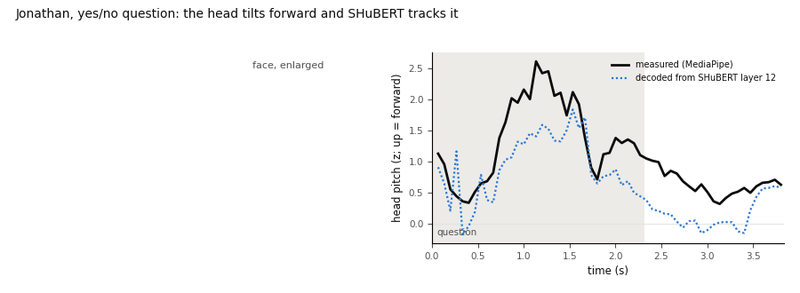
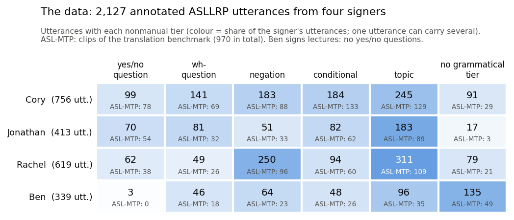
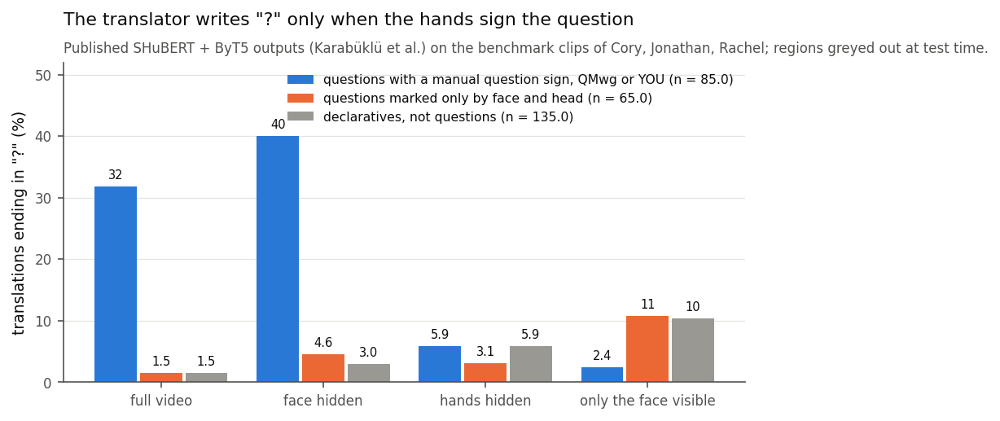
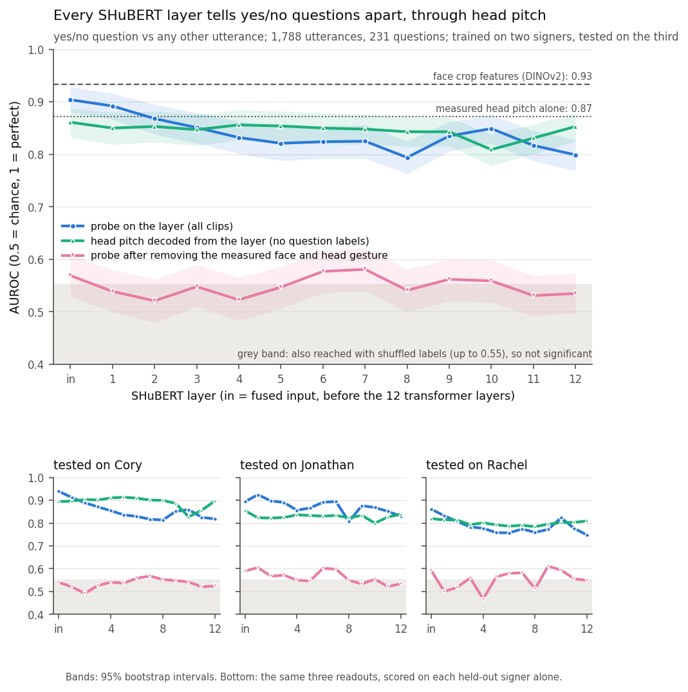
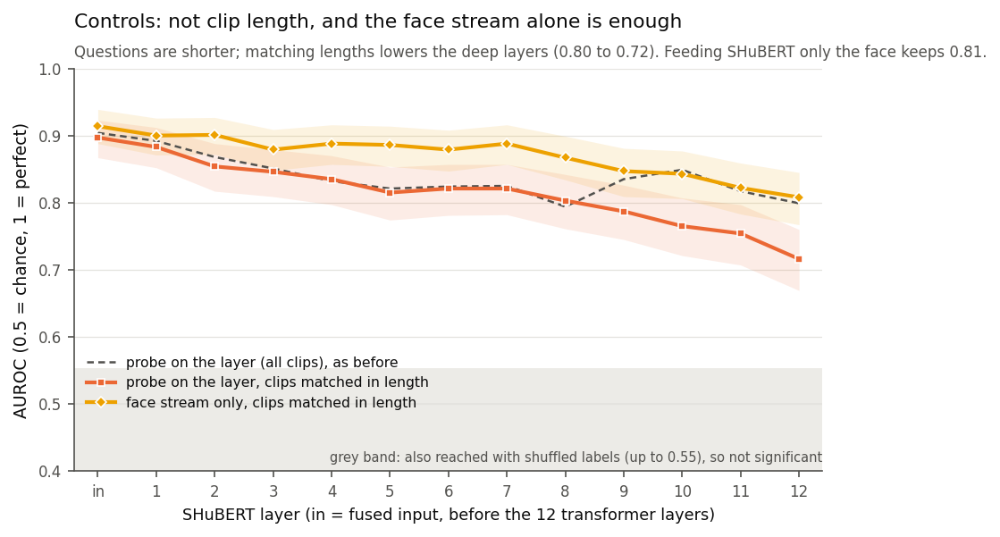
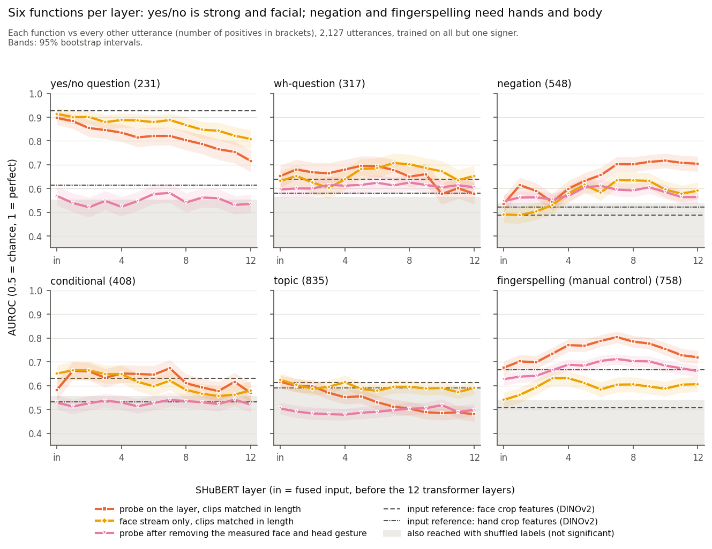
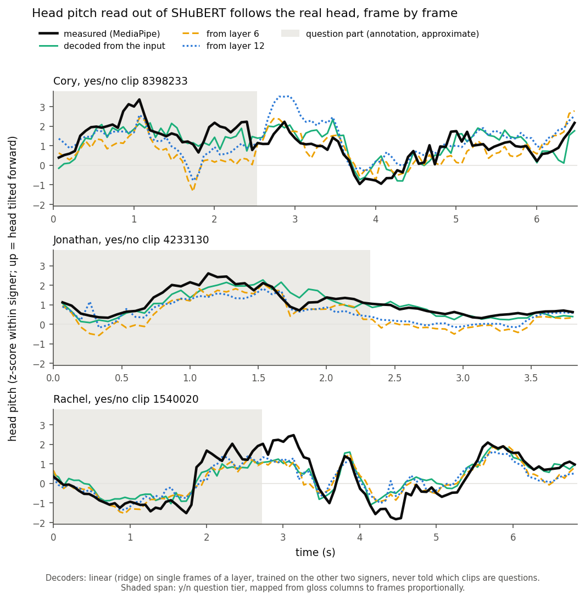
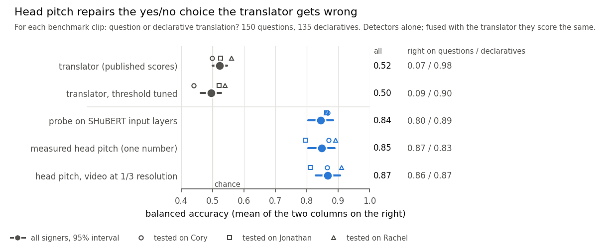

# Yes/no questions on the face: what a sign language encoder and translator see

In American Sign Language (ASL) a yes/no question is often marked only by the face and head. This project probes
**SHuBERT**, a public pretrained ASL encoder, for six grammatical functions on 2,127 annotated utterances of the ASLLRP
corpus, and tests a published **SHuBERT + ByT5** translator on the yes/no items of the **ASL-MTP** benchmark.
In short, the translator does not read the face, but the encoder keeps the yes/no cue in every layer, mostly as head
pitch (the forward tilt of the head). That one measured number repairs the translator's yes/no choice: balanced
accuracy goes from 0.52 to 0.85.

## Results



*A yes/no question by one signer, drawn from MediaPipe landmarks only. The head tilts forward during the question,
and a linear readout of SHuBERT's last layer, never told which clips are questions, follows it.*



*The data: utterances that carry each nonmanual tier, per signer. Yes/no questions come from three signers. Every
probe is trained on the other signers and tested on an unseen one.*



*The published translator ends a yes/no translation with "?" only when a manual sign (QMwg, YOU) marks the question.
Questions marked only on the face get a "?" as rarely as declaratives (1.5%).*



*Every SHuBERT layer separates yes/no questions from other utterances (AUROC 0.80–0.90). Head pitch decoded from the
layer does as well. Nothing is left once the measured face and head gesture is removed: the encoder keeps the
gesture, not a separate grammatical code.*



*Controls: questions are shorter, but the probe still works on clips matched in length. Feeding SHuBERT the face
stream alone is enough.*



*Six functions per layer. Yes/no is read from the face alone. Negation and fingerspelling are read better when the
hands are visible.*



*Head pitch measured with MediaPipe and decoded from SHuBERT layers 0, 6 and 12, frame by frame, on one yes/no clip
per signer.*



*For each benchmark clip: question or declarative translation? The translator is at chance level (0.52). A probe on
SHuBERT and measured head pitch alone reach 0.84–0.85. Head pitch still reaches 0.87 on video at 1/3 resolution.*

## Running

Requires Linux, an NVIDIA GPU, [uv](https://docs.astral.sh/uv/) and about 25 GB of disk. Everything is written to
`work/` (or to `$SIGNGRAMMAR_WORK`).

```bash
git clone https://github.com/ShesterG/SHuBERT.git work/SHuBERT
git clone https://github.com/serpilkarabuklu/SL-Models-Analysis.git work/SL-Models-Analysis

uv venv -p 3.10 .venv && uv pip install -p .venv -r requirements.txt
uv venv -p 3.10 .venv-shubert && uv pip install -p .venv-shubert -r requirements-shubert.txt
uv pip install -p .venv-shubert --no-build-isolation -e work/SHuBERT/fairseq

.venv/bin/python -c "from huggingface_hub import hf_hub_download as get; [get('ShesterG/SHuBERT', 'models/' + f, local_dir='work') for f in ['checkpoint_836_400000.pt', 'dinov2face.pth', 'dinov2hand.pth', 'yolov8n.pt', 'face_landmarker_v2_with_blendshapes.task', 'hand_landmarker.task']]"

./run.sh
```

`run.sh` rebuilds the tables in `data/`, downloads the 2,127 videos from the public DAI site (one request at a time),
extracts the features, runs the analyses into `results/` and draws `figures/`. To redraw the figures from the
included results only: `.venv/bin/python src/figures.py`. MediaPipe body landmarks vary slightly between runs, so a
full rerun from the videos matches the included results closely but not to the last digit.

## Data and models

- **ASLLRP SignStream 3 corpus**, served by the Rutgers Data Access Interface (Neidle, Opoku, Metaxas,
  [arXiv 2201.07899](https://arxiv.org/abs/2201.07899)). It is for research and education use only and is
  [not redistributed](http://www.bu.edu/asllrp/dai-terms.html). `data/utterances.csv` holds only utterance ids and
  0/1 labels derived from the public annotations.
- **ASL-MTP** and the published SHuBERT + ByT5 outputs (Karabüklü et al., [arXiv 2604.27232](https://arxiv.org/abs/2604.27232),
  CC BY 4.0). `data/benchmark_items.csv` holds the item ids and clip spans.
- **SHuBERT** (Gueuwou et al., ACL 2025, [arXiv 2411.16765](https://arxiv.org/abs/2411.16765), MIT), used as
  released, without fine-tuning.
